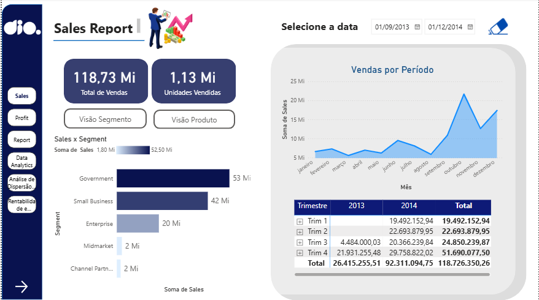
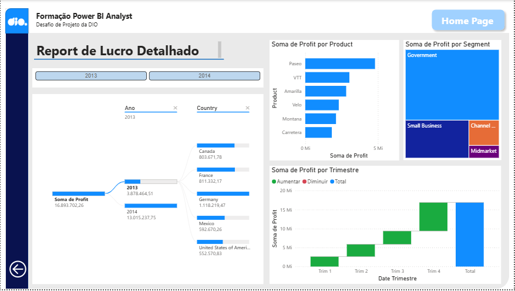
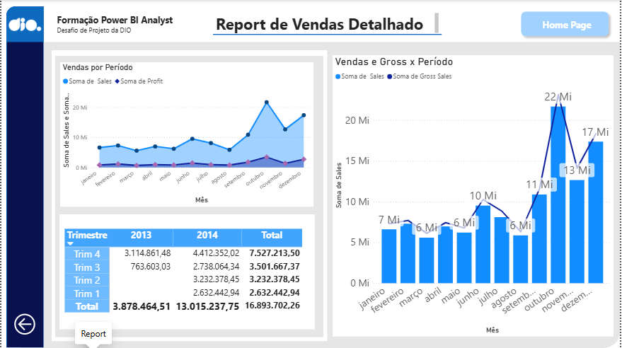
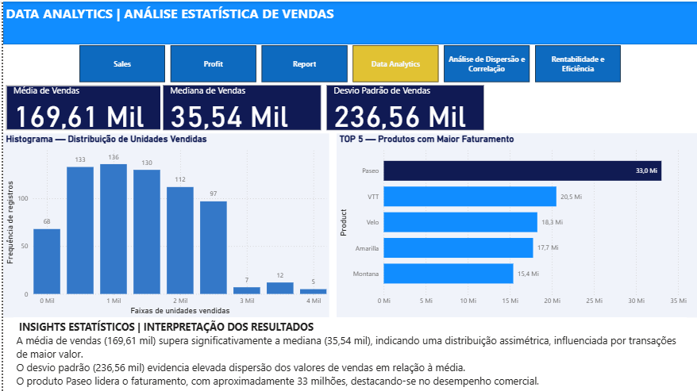
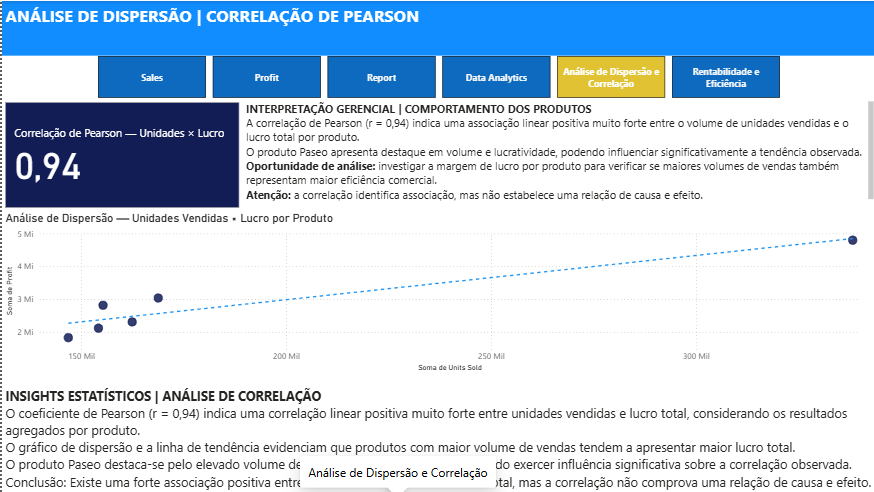
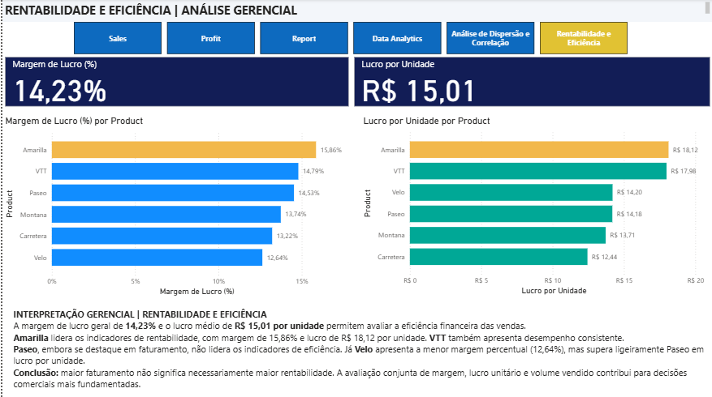

# 📊 Desafio Power BI — Data Analytics e Análises Estatísticas

## 🎯 Sobre o Projeto

Projeto desenvolvido como parte do **Bootcamp Power BI da DIO**, com o objetivo de aprimorar um relatório de vendas por meio da criação de visualizações com enfoque estatístico, aplicando conceitos de Data Analytics e Business Intelligence.

O desafio propõe modificar relatórios existentes, seguindo as orientações da expert, para ampliar a capacidade de análise e interpretação dos dados.

Além das modificações propostas, foram desenvolvidas análises complementares de correlação, rentabilidade e eficiência comercial.

## 🔄 Evolução do Relatório Original

O projeto teve como ponto de partida três páginas previamente desenvolvidas no Power BI: **Sales, Profit e Report**.

Essas páginas foram preservadas como base do relatório. Na página **Report**, foi realizado um ajuste pontual relacionado ao visual Radar Chart. Durante essa etapa, foram encontradas dificuldades de acesso ao Microsoft AppSource associadas à conta de usuário, impedindo a utilização do visual pretendido.

A principal evolução deste desafio consistiu no desenvolvimento de três páginas adicionais:

- **Data Analytics:** estatística descritiva, histograma e análise de faturamento por produto.
- **Análise de Dispersão e Correlação:** estudo da associação entre unidades vendidas e lucro, utilizando o coeficiente de Pearson.
- **Rentabilidade e Eficiência:** avaliação da margem de lucro e do lucro por unidade, permitindo comparar o desempenho financeiro dos produtos.

Dessa forma, o projeto ampliou um relatório financeiro existente, incorporando recursos estatísticos e novas perspectivas de análise gerencial.

## 📈 Páginas do Relatório

### 1. Sales — Visão Geral de Vendas

Apresenta indicadores de vendas totais e unidades vendidas, evolução mensal, desempenho por segmento e análise trimestral.



### 2. Profit — Análise de Lucro

Apresenta a distribuição do lucro por produto, segmento, país e trimestre, permitindo identificar os principais fatores que contribuem para o resultado financeiro.




### 3. Report — Análise Detalhada de Vendas

Reúne gráficos comparativos de vendas, lucro e vendas brutas, além de uma matriz de resultados trimestrais. 



### 4. Data Analytics — Análise Estatística

Página dedicada à interpretação estatística das vendas.

**Principais indicadores:**

- Média de vendas: 169,61 mil.
- Mediana de vendas: 35,54 mil.
- Desvio padrão de vendas: 236,56 mil.

Foram desenvolvidos um histograma de distribuição das unidades vendidas e um gráfico com os cinco produtos de maior faturamento.

**Insight:** a média superior à mediana sugere uma distribuição assimétrica, enquanto o desvio padrão elevado evidencia grande variabilidade nos valores de vendas.



### 5. Análise de Dispersão e Correlação

Página dedicada à investigação da associação entre o volume de unidades vendidas e o lucro total por produto.

**Coeficiente de correlação de Pearson: 0,94.**

O resultado indica uma associação linear positiva muito forte entre as variáveis agregadas por produto.

O gráfico de dispersão apresenta uma linha de tendência crescente, permitindo visualizar o comportamento dos produtos.

**Observação:** a correlação identifica associação estatística, mas não comprova causalidade.



### 6. Rentabilidade e Eficiência

Página desenvolvida para avaliar a eficiência financeira das vendas.

**Indicadores gerais:**

- Margem de lucro: 14,23%.
- Lucro por unidade: R$ 15,01.

A análise por produto evidencia que **Amarilla** apresenta a maior margem de lucro (15,86%) e o maior lucro por unidade (R$ 18,12).

Embora **Paseo** se destaque em faturamento, não lidera os indicadores de rentabilidade.

**Insight:** maior faturamento não significa necessariamente maior rentabilidade.



## 🧠 Resultados e Insights Gerenciais

As análises desenvolvidas permitiram observar:

- Assimetria na distribuição dos valores de vendas.
- Elevada variabilidade dos resultados comerciais.
- Liderança do produto Paseo em faturamento.
- Forte associação positiva entre unidades vendidas e lucro total por produto.
- Diferenças de rentabilidade entre produtos.
- Importância de analisar conjuntamente faturamento, margem de lucro e lucro por unidade.

Esses resultados demonstram como a aplicação de técnicas estatísticas pode ampliar a interpretação dos indicadores comerciais e apoiar decisões gerenciais.

## 🛠️ Tecnologias e Recursos

- Microsoft Power BI Desktop.
- Linguagem DAX.
- Visualizações estatísticas.
- Histograma.
- Gráfico de dispersão.
- Correlação de Pearson.
- Linha de tendência.
- Indicadores e cartões.
- Gráficos de barras, linhas e cascata.
- Matrizes e segmentações de dados.
- Botões de navegação.
- Análises de rentabilidade.

## 📂 Estrutura do Repositório

```text
desafio-power-bi-data-analytics-dio/
├── images/
│   ├── 01-sales.png
│   ├── 02-profit.png
│   ├── 03-report.png
│   ├── 04-data-analytics.png
│   ├── 05-dispersao-correlacao.png
│   └── 06-rentabilidade-eficiencia.png
├── Sales_Analytics_Data_Analytics_DIO.pbix
└── README.md
```

## 🚀 Aprendizados

O desenvolvimento deste projeto proporcionou a aplicação prática de conceitos de Business Intelligence e Data Analytics, incluindo estatística descritiva, análise de correlação, interpretação de distribuições, comparação de indicadores e desenvolvimento de relatórios interativos.

O projeto também reforçou a importância de transformar dados em informações compreensíveis, com foco na experiência do usuário e na tomada de decisões.

## 👤 Autor

**Marcos Roberto**

Projeto desenvolvido para fins educacionais como parte do Bootcamp Power BI da DIO.